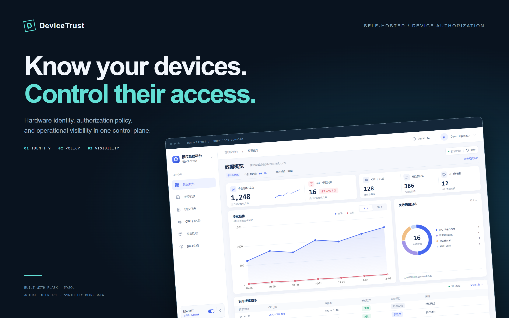
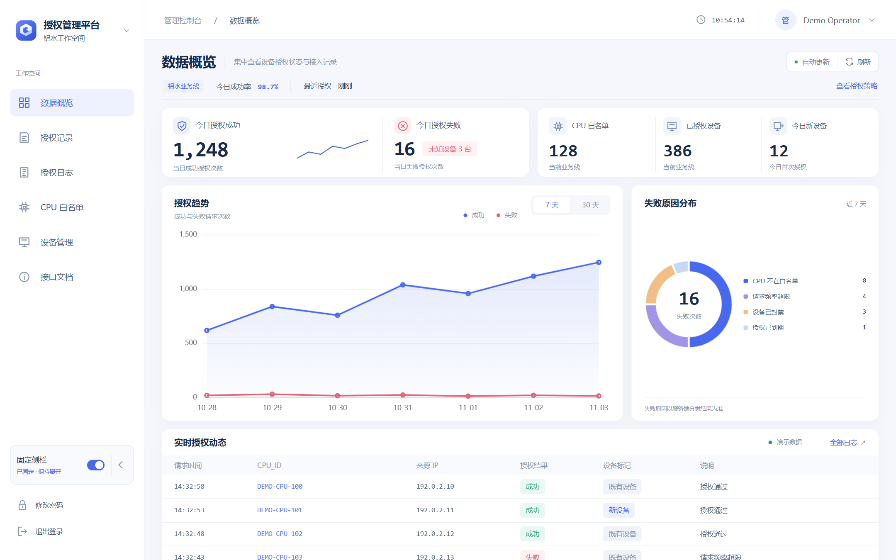
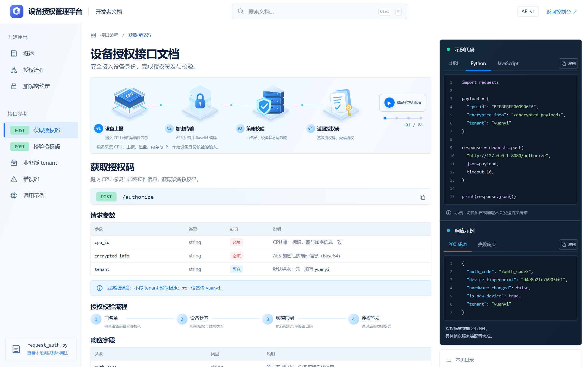
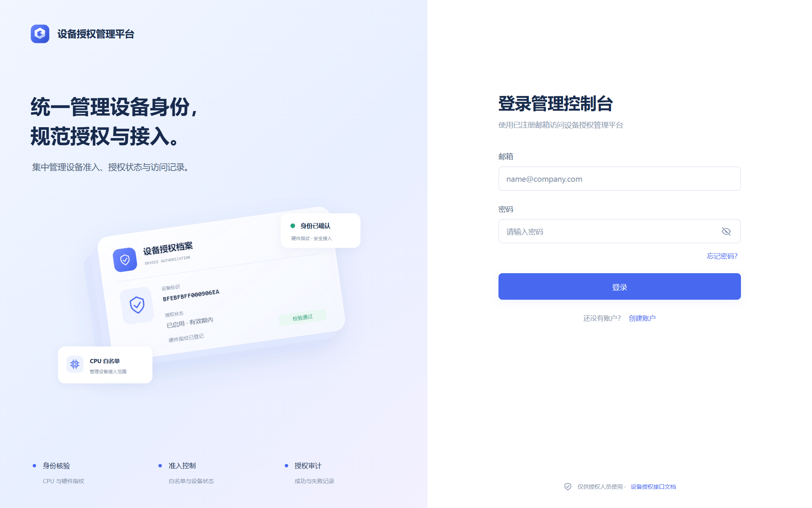

<div align="center">
  
  <p><strong>A self-hosted control plane for hardware-bound device authorization.</strong></p>
  <p>
    <a href="https://github.com/Timiocoisin/DeviceTrust/actions/workflows/check.yml"></a>
    
    
    
    
  </p>
  <p><a href="#quick-start">Quick start</a> · <a href="docs/configuration.md">Configuration</a> · <a href="docs/protocol.md">Device protocol</a> · <a href="README.zh-CN.md">简体中文</a></p>
</div>

DeviceTrust connects a device's reported hardware identity to an explicit authorization policy. A Flask control plane manages CPU allowlists, device fingerprints, business-line data, and request history; a companion Python client collects hardware information and requests an authorization code.

The interface includes a responsive operations dashboard and a developer portal with native SVG flow animations, searchable documentation, syntax-highlighted examples, and request/response comparison. No frontend build step is required.

> **Deployment boundary:** this is an existing-device protocol implementation for controlled environments. It retains legacy AES-ECB / DES-CBC compatibility and email-only password reset. Review [Security](#security) before exposing any service publicly.

## What it does

| Capability | Behavior |
| --- | --- |
| **Device admission** | CPU allowlist, enable/disable state, expiration, and fingerprint-based device blocking. |
| **Policy enforcement** | IP/CPU request limits, per-device daily authorization limits, configurable code lifetime. |
| **Hardware identity** | CPU, motherboard, disk, and memory-derived fingerprints; first-seen and hardware-change flags. |
| **Business-line separation** | Allowlist, devices, logs, records, and statistics scoped to `lvshui` or `yuanyi`. |
| **Operator console** | Search, filters, pagination, CSV import/export, alias editing, and authorization history. |
| **Live visibility** | In-process WebSocket events with polling fallback, trend charts, and failure breakdowns. |
| **Developer experience** | Public `/docs`, Python/cURL/JavaScript examples, explicit live-request forms, and `request_auth.py`. |

## Inside DeviceTrust

### 01 / Operations, at a glance

One workspace for admission decisions and the activity behind them. Track authorization volume, inspect failures, and identify newly seen hardware without leaving the overview.

<a href="docs/assets/console.png"></a>

<sub>Actual application UI, rendered with synthetic demonstration data. Counts illustrate the interface; they are not performance benchmarks.</sub>

### 02 / Built for the integration desk

A dedicated developer surface brings endpoint references, parameter contracts, and runnable examples into one view. Search the documentation, switch between Python, cURL, and JavaScript, and compare success and failure responses alongside the request.

<a href="docs/assets/developer-portal.png"></a>

### 03 / A focused entry point

The account experience shares the console's visual language, with dedicated sign-in, registration, and password-reset panels.

<details>
<summary>View the sign-in interface</summary>
<br>

</details>

## From hardware identity to operational context

| Layer | Responsibility | Implementation |
| --- | --- | --- |
| **Identity** | Decode reported hardware and derive a stable device fingerprint. | Python client · hardware decoder · SHA-256 fingerprint |
| **Decision** | Evaluate CPU admission, expiry, device blocking, request frequency, and daily usage. | Flask authorization API · tenant-scoped policies |
| **Visibility** | Persist outcomes and make request activity available to operators. | MySQL · in-process events · WebSocket / polling |

The default runner serves the **same Flask application** on ports `7070` and `8080`. WebSocket delivery and rate-limit state are process-local. See [deployment configuration](docs/configuration.md) for serving and scaling boundaries.

## Quick start

### 1. Install

Use Python 3.10+ and an available MySQL server. The reference client supports hardware collection on Windows and Linux; results depend on OS permissions and hardware availability.

```bash
git clone https://github.com/Timiocoisin/DeviceTrust.git
cd DeviceTrust
python -m venv .venv
# Windows: .venv\Scripts\activate
# macOS / Linux: source .venv/bin/activate
python -m pip install -r requirements.txt
```

### 2. Create private configuration

```bash
python scripts/init_env.py
```

The initializer creates `.env` with generated session and protocol keys, refuses to overwrite an existing configuration, and does not print secrets. Edit the MySQL settings locally:

```dotenv
MYSQL_HOST=127.0.0.1
MYSQL_USER=devicetrust
MYSQL_PASSWORD=<your-local-database-password>
MYSQL_DB=devicetrust
```

Provision a dedicated MySQL account with the DDL/DML permissions required to initialize and maintain this database. Startup creates the database/tables when permitted and applies schema compatibility updates. Use a separate test database when evaluating an existing deployment.

Both the server and device client must use the **same private AES/DES settings**. Generate a new configuration per independent installation; changing keys invalidates compatibility with previously issued codes and provisioned clients.

### 3. Run

```bash
python app.py
```

| Entry point | Default URL |
| --- | --- |
| Login and registration | `http://127.0.0.1:7070/` |
| Operator console | `http://127.0.0.1:7070/message` |
| Interactive API documentation | `http://127.0.0.1:7070/docs` |
| Device authorization | `POST http://127.0.0.1:8080/authorize` |
| Authorization-code verification | `POST http://127.0.0.1:8080/verify_auth_code` |

Create a console account, select a business line, and add the device's CPU ID to its allowlist before requesting a code. Registration currently creates a general console account; there is no administrator/user role hierarchy.

### 4. Connect a device

```bash
# Default business line: lvshui
python request_auth.py --host 127.0.0.1 --port 8080

# Explicit business line: yuanyi
python request_auth.py --tenant yuanyi --host 127.0.0.1 --port 8080

# Ignore the locally cached authorization code
python request_auth.py --tenant yuanyi --force
```

The client writes `auth_code.bin` locally. That file and `.env` are excluded from Git. Example payloads and response contracts are documented in [Device protocol](docs/protocol.md); the full in-app guide is available at `/docs`.

## Configuration at a glance

| Setting | Default / requirement |
| --- | --- |
| `SECRET_KEY` | Required for console sessions; generated by the initializer. |
| `AES_KEY` | Required; exactly 16, 24, or 32 UTF-8 bytes. |
| `DES_KEY`, `DES_IV` | Required; exactly 8 UTF-8 bytes each. |
| `FLASK_HOST` | `127.0.0.1` in the example configuration. |
| `FLASK_PORT`, `AUTHORIZE_PORT` | `7070`, `8080`. |
| `DAILY_AUTH_LIMIT_PER_DEVICE` | `50`; `0` disables this limit. |
| `RATE_LIMIT_WINDOW_SECONDS` | `60`. |
| `RATE_LIMIT_MAX_PER_IP`, `RATE_LIMIT_MAX_PER_CPU` | `30`, `20`. |
| `AUTH_CODE_MAX_AGE_SECONDS` | `86400`; `0` disables age validation. |
| `LOG_RETENTION_DAYS` | `90`. |
| `STALE_DAYS` | `7`. |

See [.env.example](.env.example) and [Configuration](docs/configuration.md) for setup and operational details.

## Repository map

```text
app.py                 Flask views, management APIs, policies, and MySQL initialization
auth_service.py        Hardware decoding, fingerprints, code generation and verification
crypto_config.py       Explicit key loading and byte-length validation
live_hub.py            Bounded, in-process subscriber event hub
request_auth.py        Device hardware collection and authorization client
templates/             Login, operations console, and API documentation
static/                Local styles, scripts, SVG components, and vendored Chart.js
scripts/init_env.py     Non-destructive private configuration initializer
tests/                 Offline protocol and session/view checks
docs/                  Configuration, protocol notes, and repository artwork
```

## Development checks

```bash
python -m unittest discover -s tests -v
```

Tests use generated, process-local keys and cover encryption round trips, malformed/expired codes, hardware-derived fingerprints, key validation, protected views, logout behavior, and event delivery. They do not connect to MySQL or authorize real devices. The GitHub Actions workflow runs the suite on Python 3.11 and 3.12.

## Security

DeviceTrust does **not** provide hardware attestation, per-user RBAC, or a modern authenticated-encryption protocol. Tenant separation is application-level business-line scoping; it is not a user authorization model.

The current account flow permits registration and email-only password reset without identity verification. Restrict account routes to trusted operators, and replace that reset flow before public deployment. Legacy AES-ECB / DES-CBC is retained for interoperability, not recommended for a new protocol. See [SECURITY.md](SECURITY.md) for the complete boundaries.

The included Werkzeug runner is intended for local/trusted-network evaluation. Public deployment needs hardened account handling, HTTPS, appropriate session protections, a WebSocket-compatible serving strategy, and careful handling of proxy-derived client IPs. Never commit `.env`, device codes, real device inventories, database dumps, or operational logs.

## Third-party components

Chart.js 4.4.1 is vendored for local chart rendering. Its copyright and MIT notice are retained in [`static/js/vendor/LICENSE.chartjs.txt`](static/js/vendor/LICENSE.chartjs.txt). Product screenshots are captured from the application using synthetic demonstration data. The cover is a presentation composition of that interface; none of these images contains operational device records.
