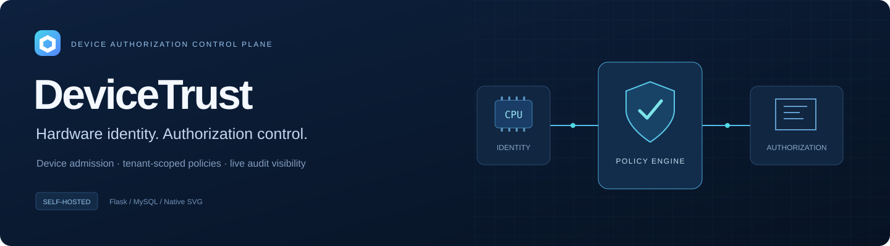

<div align="center">
  
  <h1>DeviceTrust</h1>
  <p><strong>面向设备身份、授权策略与接入审计的自托管控制台。</strong></p>
  <p><a href="README.md">English</a> · <a href="docs/configuration.md">配置说明</a> · <a href="docs/protocol.md">设备协议</a></p>
</div>

DeviceTrust 将设备上报的 CPU、主板、磁盘和内存信息转换为硬件指纹，在 CPU 白名单、设备状态、请求频率和日授权额度校验后签发授权码。控制台负责设备准入、业务线数据管理、实时动态和授权记录追溯。

前端由 Flask 模板、原生 JavaScript 与 SVG 组件组成，无需 npm 构建。接口文档提供搜索、代码语言切换、请求/响应对照和四步原生 SVG 流程演示。

## 能力

| 模块 | 内容 |
| --- | --- |
| 数据概览 | 授权指标、趋势、失败原因分布、实时请求动态。 |
| CPU 白名单 | 添加、状态切换、到期时间、行内备注、CSV 导入导出。 |
| 设备管理 | 硬件指纹、设备别名、封禁/解封、CPU 分组、授权历史。 |
| 记录与日志 | 成功硬件记录、成功/失败全量日志、条件筛选、分页与导出。 |
| 业务线隔离 | `lvshui`（铝水）与 `yuanyi`（元一）分别管理数据。 |
| 设备端接入 | `/authorize`、`/verify_auth_code` 与 `request_auth.py`。 |

## 快速运行

需要 Python 3.10+ 和可用的 MySQL 服务。

```bash
git clone https://github.com/Timiocoisin/DeviceTrust.git
cd DeviceTrust
python -m venv .venv
# Windows：.venv\Scripts\activate
# Linux / macOS：source .venv/bin/activate
python -m pip install -r requirements.txt
python scripts/init_env.py
```

初始化脚本会生成私有 `.env`，不会覆盖已有文件或打印密钥。编辑其中的数据库地址、账户、密码和数据库名；数据库账户需要具备初始化表结构和日常读写所需的权限。应用启动会创建所需数据库/表并执行兼容性结构检查，接入已有环境前应使用独立测试库验证。

```bash
python app.py
```

- 登录：`http://127.0.0.1:7070/`
- 控制台：`http://127.0.0.1:7070/message`
- 接口文档：`http://127.0.0.1:7070/docs`
- 设备授权：`POST http://127.0.0.1:8080/authorize`
- 校验授权码：`POST http://127.0.0.1:8080/verify_auth_code`

创建控制台账户后，选择业务线，将设备 CPU ID 加入对应白名单。服务端与设备端需要安全配置同一套 AES/DES 参数，不同部署应使用独立密钥。

```bash
python request_auth.py --host 127.0.0.1 --port 8080
python request_auth.py --tenant yuanyi --host 127.0.0.1 --port 8080
python request_auth.py --tenant yuanyi --force
```

客户端支持 Windows / Linux 硬件采集，实际可用字段受系统权限与硬件环境影响。授权码保存在本地 `auth_code.bin`，该文件及 `.env` 不应上传仓库。

## 运行边界

两个默认端口提供的是同一个 Flask 应用，不是独立的安全边界。实时事件总线和限流状态保存在进程内；多进程部署需要另行设计共享事件与状态存储。

当前实现兼容既有的 AES-ECB / DES-CBC 协议，不代表硬件可信证明，也不建议直接将其作为新系统的加密协议。业务线隔离不等于用户级 RBAC；注册账户目前具有通用控制台权限。

**当前忘记密码流程仅基于邮箱，不验证邮箱归属；注册也未限制为受邀账户。对公网部署前必须替换或限制这些账户入口。** 内置 Werkzeug 服务用于本地或受控网络评估，不应将这份演示当作已完成安全加固的公网服务。完整说明见 [SECURITY.md](SECURITY.md)。

## 验证

```bash
python -m unittest discover -s tests -v
```

测试覆盖硬件加解密、授权码时效、异常密文、硬件指纹、会话保护、退出行为和事件推送；使用临时测试密钥，不连接真实数据库或设备。GitHub Actions 提供 Python 3.11 / 3.12 检查。

完整架构、目录、配置表与第三方组件声明见 [English README](README.md)。
